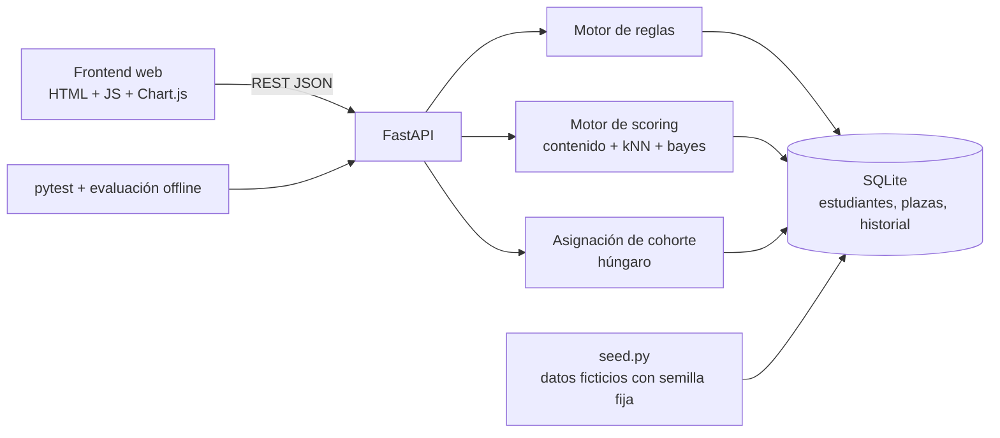

# Plan — Proyecto Final Corte II e-Business (Ruta A)

**Equipo:** Eduardo Rafael de Avila Florez · Julio Cesar Martinez · Alex Betin Uparela
**Entrega grupal:** 24-nov-2026 · **Sustentaciones:** 25 al 27-nov (15 min, individuales)
**Decisión:** Ruta A, sistema de recomendación. Prototipo web. Documento final en .docx.

---

## 1. Problema (primero el problema, después la tecnología)

**Título:** La asignación de escenarios de práctica no usa la información que el propio proceso ya produce.

| Elemento | Contenido | Evidencia [L] = lineamientos |
|---|---|---|
| Situación | La Coordinación de Prácticas (CP) organiza "el proceso de selección y asignación de sitio de práctica" para cada cohorte. El asesor acompaña la "pre-asignación de área, énfasis y escenarios". | [L] 3.4.i, 3.5.a |
| Información que ya existe y no se cruza | 1) La pre-práctica identifica las potencialidades, habilidades y preferencias ocupacionales del estudiante. 2) Los estudiantes evalúan a supervisores y escenarios. 3) Los supervisores evalúan el desempeño en dos cortes. 4) La Coordinación Académica analiza las "evaluaciones de estudiantes, asesores, supervisores y escenarios". | [L] 2.j, 10.4.1, 10.4.2, 3.3.g |
| Restricciones que la CP debe verificar a mano | Convenio o carta de intención vigente. Ningún vínculo familiar hasta 3.er grado de consanguinidad, 2.º de afinidad o 1.º civil con propietarios, directivos o el supervisor. Si el estudiante trabaja en la organización, las funciones deben ser acordes al perfil. Vacunación en escenarios de salud. Seguro internacional para prácticas en el exterior. Certificado médico en caso de embarazo. Modalidad y programa compatibles. Cupos disponibles. | [L] 9, 10.1, 10.3, 8, 6 |
| Actores | Afectados: estudiante, CP, asesor, supervisor/organización y Coordinación Académica. Quien decide sigue siendo la CP. | [L] 3 |
| Manifestación | La asignación se hace caso a caso, con muchas variables en conflicto: preferencias, competencias, cupos, reglas e historial del escenario. Cada cohorte lleva decenas de estudiantes y escenarios. | Hipótesis analítica, igual que en el diagnóstico anterior |
| Consecuencias | Asignaciones poco pertinentes, bajo desempeño, retiros o cambios de escenario por PQRS ([L] 10.1) y reprocesos de la CP. Además, el riesgo de violar una regla, como el parentesco o un convenio vencido. | [L] 10.1, 9 |
| Por qué vale la pena | La asignación condiciona toda la práctica: si el escenario no es pertinente, nada de lo que sigue lo corrige. Los datos necesarios ya existen y solo falta procesarlos. | — |
| Delimitación | Un programa (Ingeniería de Sistemas) y una cohorte. El prototipo **recomienda**; no asigna automáticamente. La decisión sigue siendo humana. | — |

**Relación con el proyecto anterior:** amplía la actividad **A3 del AS-IS** ("Seleccionar y asignar escenario", CP con rol R/A en la RACI) y la oportunidad O1. De ese documento se reutilizan las secciones de actores, RACI, AS-IS y referencias.

## 2. Justificación de la ruta (preguntas obligatorias, guía §3.2)

| Pregunta | Respuesta |
|---|---|
| ¿Por qué un recomendador? | El problema es de **ordenar opciones según su ajuste** para cada estudiante, con información heterogénea, y no de garantizar la integridad de registros. Por eso Blockchain no aporta aquí: no hay desconfianza entre partes sobre un dato, sino una decisión con muchas variables. |
| Característica que aporta valor | Ranking personalizado que combina contenido (perfil frente a escenario) con una señal colaborativa (cómo les fue a estudiantes parecidos en ese escenario), más una explicación por factor. |
| Limitaciones | Arranque en frío (escenario nuevo sin historial), sesgo de popularidad, datos ficticios en el prototipo, pesos fijados por criterio experto y no aprendidos, y dependencia de la calidad de las evaluaciones. |
| ¿Por qué no basta algo convencional? | Un filtro o una hoja de cálculo deja las opciones *válidas*, pero no las *ordena* según el ajuste ni aprovecha el historial. Un ranking manual no escala con decenas de estudiantes por decenas de plazas, ni deja una justificación reproducible. Esto se demuestra en la prueba P8 (frente a la línea base). |

## 3. Diseño de la recomendación (guía §4.1)

| Ítem exigido | Diseño |
|---|---|
| Quién recibe | **CP** (principal): ranking por estudiante y propuesta de asignación de la cohorte. **Estudiante** (secundario): su top-N con explicación. |
| Qué se recomienda | Una **plaza de práctica** (organización + área + cupo) para un estudiante. |
| Variables | Estudiante: programa, modalidad preferida, área/énfasis preferido, vector de competencias de la pre-práctica (SER/SABER/HACER por área), municipio, disponibilidad, condiciones (trabaja en, familiares en, vacunación, seguro, certificado médico). Plaza: organización, programa y área, competencias requeridas, municipio, cupos, vigencia del convenio, sector salud o internacional. Historial: notas de desempeño de practicantes anteriores por escenario y evaluación del escenario/supervisor hecha por estudiantes. |
| Método | **Híbrido en 3 etapas.** (1) **Filtro de reglas duras** tomadas de los lineamientos; cada exclusión guarda su regla y su referencia [L]. (2) **Score ponderado** `S = Σ wᵢ·fᵢ` con fᵢ ∈ [0,1]: afinidad de área, ajuste de competencias (similitud coseno con penalización por brechas), calidad del escenario (**promedio bayesiano** para controlar el arranque en frío), éxito de perfiles similares (**kNN** sobre el historial: componente colaborativa), logística (municipio/modalidad). (3) **Asignación global opcional** de la cohorte, respetando cupos, mediante asignación óptima (algoritmo húngaro con plazas replicadas por cupo). |
| Presentación | Tabla top-N con score, barras de contribución por factor, lista de plazas excluidas con su motivo y vista de propuesta de cohorte. |
| Explicación | La descomposición aditiva hace que la suma de las contribuciones sea exactamente el score. Se acompaña de frases generadas ("Afinidad alta con Desarrollo de Software (+0,24)") y de la regla [L] que excluye cada plaza descartada. |
| Parámetros editables en vivo | Pesos wᵢ, N, k del kNN, prior m del promedio bayesiano y activar o desactivar cada regla. Esto prepara el punto "modifique un parámetro y explique" de la sustentación. |

**Trazabilidad que exige la guía §5:**

| Problema | Necesidad | Decisión de diseño | Componente | Resultado esperado |
|---|---|---|---|---|
| Se asignan escenarios que violan reglas | Excluir lo no elegible | Filtro de reglas con motivo | `rules.py` | 0 recomendaciones inválidas (P1–P3) |
| Asignación poco pertinente | Ordenar por ajuste | Score ponderado por contenido | `scoring.py` | Mejor NDCG@5 que la línea base (P8) |
| El historial no se usa | Aprovechar evaluaciones | kNN + promedio bayesiano | `scoring.py` | El escenario bien evaluado sube en el ranking (P5) |
| Cupos limitados y choques entre estudiantes | Resolver la cohorte | Asignación óptima | `assignment.py` | Ningún cupo excedido (P7) |
| La decisión debe ser defendible | Explicar | Descomposición aditiva + motivos | `explain.py` + UI | Suma de contribuciones = score (P6) |

## 4. Arquitectura

## 5. Evaluación de tecnologías (≥2 alternativas por componente; los criterios los define el equipo)

Criterios y pesos: ajuste al problema 30 %, explicabilidad 25 %, facilidad de demostración y reproducción 20 %, esfuerzo en 2 días 15 %, escalabilidad 10 %.

| Componente | Alternativas | Selección y motivo |
|---|---|---|
| Método | (a) Híbrido reglas + score ponderado + kNN; (b) filtrado colaborativo puro (factorización de matrices); (c) clasificador ML (p. ej. random forest que predice el desempeño); (d) LLM | **(a)**. Hay pocos datos (el CF puro sufre de dispersión y arranque en frío). Es explicable por construcción. Las reglas normativas no se pueden "aprender": deben ser duras. (c) y (d) son menos explicables y el LLM no es reproducible. |
| Explicación | Descomposición aditiva propia; SHAP/LIME | **Aditiva**: es exacta para un modelo lineal. SHAP solo se justifica con modelos de caja negra. |
| Backend | FastAPI; Django; Flask | **FastAPI**: API tipada, documentación OpenAPI automática (útil en la demo) y el mismo lenguaje que el motor (numpy/scipy). Django está sobredimensionado para una API de recomendación. |
| Frontend | HTML/JS + Chart.js servidos por FastAPI; React + Vite | **HTML/JS**: no requiere compilación, se ejecuta con un solo comando y lo pueden explicar los 3 integrantes. |
| Datos | SQLite; PostgreSQL; CSV en memoria | **SQLite**: un archivo reproducible. PostgreSQL queda documentado como opción para producción. |
| Asignación | `scipy.optimize.linear_sum_assignment`; greedy por score; programación lineal (PuLP) | **scipy** da el óptimo global. El greedy queda como línea base comparativa en la prueba P7. |

Las evidencias se toman de la documentación oficial (se citan las URL) y de las pruebas P7 y P8.

## 6. Datos

Datos **ficticios y reproducibles** (`seed.py` con semilla fija): unos 60 estudiantes, 25 organizaciones, unas 40 plazas y unos 400 registros históricos de desempeño y evaluación. El generador incluye relaciones *plantadas* (por ejemplo, los estudiantes fuertes en BD rinden mejor en las plazas de BD) para que la evaluación offline tenga sentido. Esto se declara como limitación. No hay datos personales reales (Ley 1581 de 2012).

## 7. Pruebas (cada una documenta: qué / datos / procedimiento / esperado / obtenido / evidencia / conclusión)

| ID | Qué comprueba | Tipo |
|---|---|---|
| P1 | El estudiante con un familiar en la organización X no recibe X; se muestra el motivo con [L] §9 | Funcional |
| P2 | Una plaza con convenio vencido o sin cupo queda excluida | Funcional |
| P3 | Una plaza de salud sin vacunación queda excluida; con vacunación, aparece | Funcional |
| P4 | Subir el peso de "logística" reordena el ranking hacia plazas locales | Sensibilidad |
| P5 | Un escenario nuevo sin historial recibe el prior bayesiano (no queda en 0 ni en 5) | Arranque en frío |
| P6 | La suma de las contribuciones es igual al score (tolerancia 1e-9) | Explicabilidad |
| P7 | La asignación de la cohorte no excede los cupos; bienestar total del húngaro ≥ greedy | Asignación |
| P8 | Evaluación offline (hold-out del historial): NDCG@5 y Precision@5 del método frente a la línea base aleatoria y la de popularidad | Calidad |
| P9 | Un estudiante sin plazas elegibles recibe un mensaje claro, no un error | Límite |
| P10 | Sesgo de popularidad: concentración de las recomendaciones en las plazas más votadas | Limitación |
| P11 | Determinismo: la misma entrada produce la misma salida | Reproducibilidad |

Evidencias: salida de pytest, `resultados_evaluacion.json` y capturas de la UI.

## 8. Mapa de entregables (guía §9) y rúbrica (§10)

| # | Entregable | Sección del documento | Rúbrica |
|---|---|---|---|
| 1–2 | Problema, actores y contexto | §1 de este plan + actores/RACI/AS-IS A3 del proyecto anterior | Problema 10 % |
| 3 | Justificación de la ruta | §2 | Problema 10 % |
| 4–5 | Diseño y flujo | §3 + diagrama de secuencia | Diseño 10 % |
| 6 | Arquitectura | §4 | Diseño 10 % |
| 7 | Datos | §6 + diccionario de datos | Diseño 10 % |
| 8–9 | Comparación y selección | §5 | Selección 10 % |
| 10–11 | Prototipo y código | Repo `recomendador-practicas/` + README | Prototipo 15 % |
| 12 | Pruebas y evidencias | §7 | Pruebas 5 % |
| 13–14 | Limitaciones y conclusiones | §2 limitaciones + resultados P8/P10 | Pruebas 5 % |

## 9. Cronograma

| Cuándo | Trabajo |
|---|---|
| 22-nov | Generador de datos, motor de reglas y scoring, API, pruebas P1–P11 |
| 23-nov | UI (ranking, explicación, pesos en vivo, cohorte), evaluación offline, capturas y redacción del documento |
| 24-nov (mañana) | Revisión final, .docx, empaquetado (zip con código + README) y **entrega** |
| 24-nov (tarde) | Guion de demo de 15 min y banco de preguntas del docente con respuestas; cada integrante ensaya la demo completa |

**Sustentación individual:** los 3 integrantes deben dominar todo el proyecto. Se preparará una guía con: guion de 5 min de presentación + 5 min de demo; 30 preguntas probables (conceptos de recomendadores, arranque en frío, kNN, promedio bayesiano, NDCG, por qué no Blockchain, por qué no ML) con sus respuestas; y 5 escenarios "¿qué pasa si…?" listos para ejecutar en vivo.
