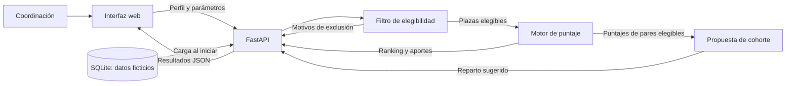

# Diseño y arquitectura de la solución

## Alcance y actores

El prototipo apoya la selección de plazas de Ingeniería de Sistemas durante la incorporación. Coordinación de Prácticas es el usuario principal y conserva la decisión final (§3.4.i de los Lineamientos). El asesor acompaña la preasignación (§3.5.a). El estudiante aporta preferencias y competencias en el proceso de prepráctica (§2.j). La organización aporta las condiciones de la plaza. El historial ficticio representa evaluaciones de practicantes y escenarios. El prototipo no conecta sistemas institucionales ni registra asignaciones oficiales.

## Flujo y componentes

1. **Entrada:** Coordinación elige un perfil ficticio y solicita una recomendación. Puede ajustar los pesos o ensayar cambios de municipio y modalidad. Esos cambios no modifican SQLite.
2. **Filtro:** el motor contrasta cada plaza con el perfil y el escenario. Comprueba, entre otras condiciones, la compatibilidad de programa, la vigencia del convenio al inicio simulado y la disponibilidad de cupo. Si la plaza incumple una regla, queda fuera del ranking y se indica el motivo. El filtro representa un subconjunto de los controles institucionales, no certifica elegibilidad oficial.
3. **Puntaje:** para las plazas elegibles, el motor multiplica cada factor por su peso normalizado y suma los aportes. Usa área, competencias, evaluación del escenario, desempeño de perfiles similares y logística. Una plaza sin historial usa los promedios generales en los factores históricos. El ranking se ordena por puntaje descendente y, en caso de empate, por identificador de plaza.
4. **Salida:** la interfaz presenta las primeras N plazas y los aportes de cada factor. También muestra las exclusiones y avisa si ninguna plaza es elegible. En Cohorte, un cálculo separado usa los perfiles originales para proponer un reparto compatible con los cupos. Evalúa primero cuántos estudiantes puede ubicar y después el puntaje total.

## Datos y su utilización

| Datos | Campos del prototipo | Uso |
|---|---|---|
| Perfil | Programa, preferencias de área y modalidad, municipio, niveles de competencias y condiciones de elegibilidad ficticias | Filtrar, calcular afinidad y comparar con perfiles anteriores |
| Organización | Sector, país, municipio y fecha de vigencia del convenio | Aplicar condiciones del escenario y calcular logística |
| Plaza | Área, modalidad, competencias requeridas y cupos disponibles | Aplicar restricciones, medir cobertura y limitar el reparto |
| Historial | Identificador de plaza, competencias del practicante, desempeño y valoración del escenario | Estimar los dos factores históricos sin consultar expedientes reales |
| Parámetros | Pesos, número de recomendaciones, vecinos y fuerza del promedio general | Ajustar el ranking y explorar escenarios reproducibles |

## Trazabilidad del diseño

| Problema | Necesidad | Decisión de diseño | Componente | Resultado esperado |
|---|---|---|---|---|
| Algunas opciones no cumplen las condiciones del perfil o del escenario | Separar requisitos de preferencias | Aplicar reglas antes de puntuar | `app/rules.py` | Una plaza inelegible queda fuera y muestra el motivo |
| Varias plazas elegibles ofrecen distintos grados de ajuste | Priorizar por estudiante | Combinar factores con pesos explícitos | `app/scoring.py` | Un cambio relevante del perfil o de los pesos puede reordenar la lista |
| Un puntaje total no explica por qué una plaza aparece primero | Poder reconstruir la recomendación | Mostrar cada aporte y su explicación | `app/scoring.py`, `app/main.py` e interfaz web | Coordinación identifica qué factores explican el puntaje |
| Varios estudiantes pueden preferir los mismos cupos | Comparar un reparto de todo el grupo | Optimizar cantidad asignada y luego puntaje | `app/assignment.py` | La propuesta no supera los cupos ni asigna dos veces al mismo estudiante |

Ver `validacion.md` para las comprobaciones y `comparacion-tecnologica.md` para las decisiones de herramientas.
